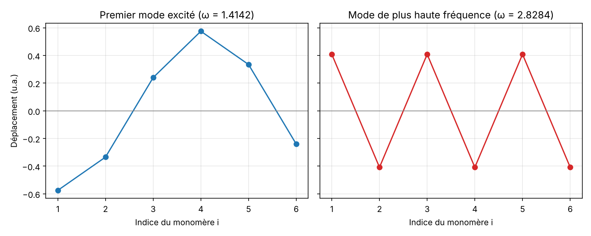

# 02 – Modes propres de vibration d'un polymère

**Problème.** Un polymère en anneau de 6 monomères reliés par des ressorts : trouver ses modes de vibration (fréquences et déformations).

**Méthode.**
- Équations de Newton mises sous la forme `A x = λ x`, avec λ = ω² et `A` symétrique réelle.
- Méthode de la puissance : valeur propre dominante (mode de plus haute fréquence).
- Méthode de la puissance inverse avec décalage, appuyée sur un pivot de Gauss codé à la main : modes de basse fréquence.
- Vérification avec `numpy.linalg.eigh`.

**Résultats.**
- Valeurs propres : λ = 0, 2, 2, 6, 6, 8, soit ω = 0 ; 1,414 ; 2,449 ; 2,828.
- Le mode nul est une translation de l'ensemble ; les modes λ = 2 et λ = 6 sont dégénérés (deux modes de même fréquence).
- Premier mode excité : ω = √2 ≈ 1,414.

**Lancer.** `python polymere_modes_propres.py`

Le rapport complet est dans [rapport.pdf](rapport.pdf).
