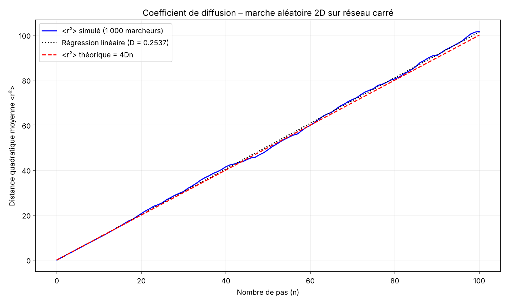
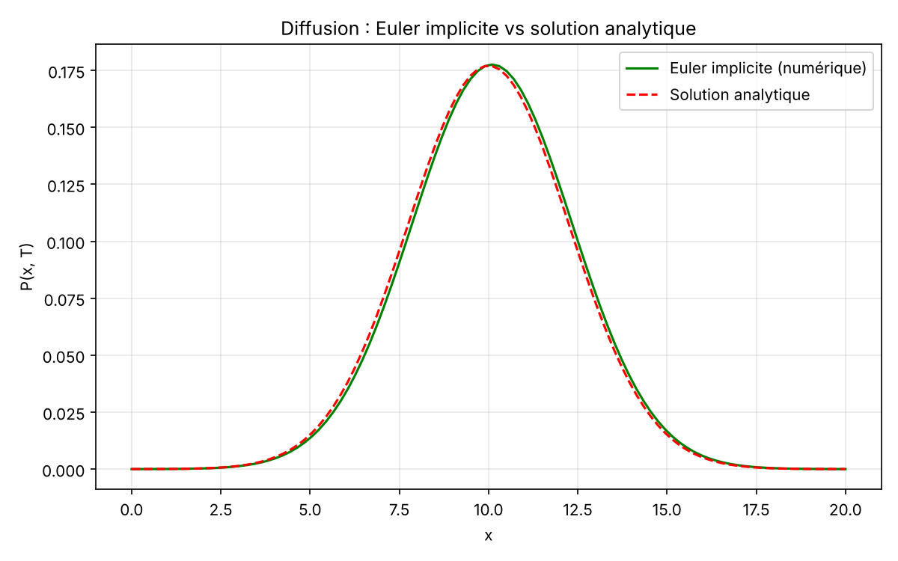

# 03 – Marche aléatoire et équation de diffusion

**Problème.** Comment un mouvement aléatoire microscopique (mouvement brownien) donne-t-il naissance à un comportement diffusif macroscopique ?

**Méthode.**
1. **Simulation Monte-Carlo** de 1 000 marches aléatoires de 100 pas sur un réseau carré 2D. Le coefficient de diffusion D est estimé par régression linéaire de la distance quadratique moyenne : ⟨r²⟩ = 4Dn.
2. **Démonstration analytique** (dans le rapport) : passage de la marche aléatoire à l'équation de diffusion, puis à sa solution gaussienne.
3. **Résolution numérique** de l'équation de diffusion 1D par un schéma d'Euler implicite (différences finies). Chaque pas de temps demande de résoudre un système tridiagonal, par pivot de Gauss codé à la main.

**Résultats.**
- D mesuré = 0,2537, pour une valeur théorique de 0,25 (écart de 1,5 %).
- Le schéma d'Euler implicite reproduit la solution analytique : erreur relative globale de 0,5 % et écart-type à 0,8 % de la valeur théorique √(2Dt).

**Lien avec la finance.** Le mouvement brownien est la base du modèle de Black-Scholes, et l'EDP de Black-Scholes se ramène, par changement de variables, à l'équation de la chaleur résolue ici. Les schémas de différences finies comme Euler implicite servent aussi à pricer des options.

**Lancer.** `python marche_aleatoire_diffusion.py`

Le rapport complet est dans [rapport.pdf](rapport.pdf).
