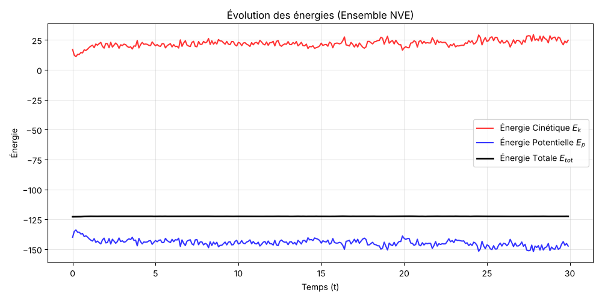
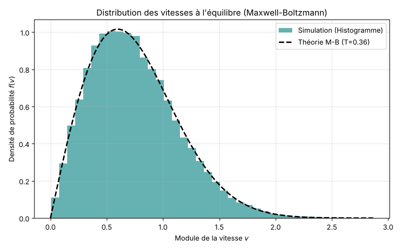
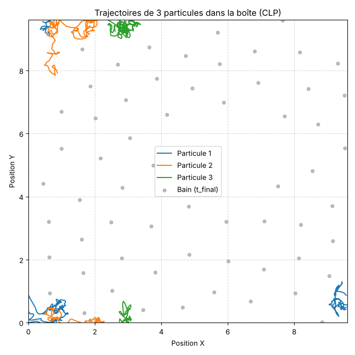

# 04 – Dynamique moléculaire

**Problème.** Simuler un gaz de 64 particules en 2D qui interagissent par le potentiel de Lennard-Jones, et vérifier qu'il atteint l'équilibre thermodynamique.

**Méthode.**
- Intégration des équations de Newton par l'algorithme de Verlet des vitesses (3 000 pas, dt = 0,01).
- Conditions aux limites périodiques et convention de l'image minimum.
- Vitesses initiales tirées selon une loi normale, quantité de mouvement totale annulée.
- Optimisation : la 3ᵉ loi de Newton (F_ij = −F_ji) divise par deux le nombre de forces calculées, et un rayon de coupure ignore les interactions lointaines.

**Résultats.**
- L'énergie totale reste constante, ce qui valide l'intégrateur et le pas de temps.
- Après thermalisation, l'histogramme des vitesses suit la loi de Maxwell-Boltzmann 2D.

**Complexité.** Le calcul des forces est en O(N²) par pas de temps. Pour de grands systèmes, des listes de Verlet ou des cellules liées le ramèneraient à O(N).

**Lancer.** `python dynamique_moleculaire.py` (environ 30 secondes)

Le rapport complet est dans [rapport.pdf](rapport.pdf).
